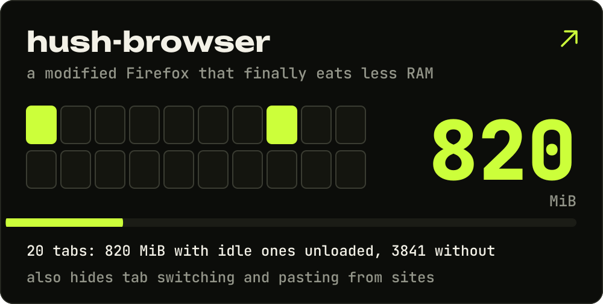
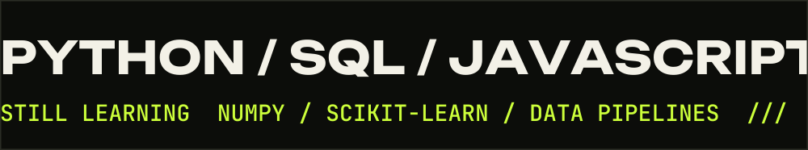
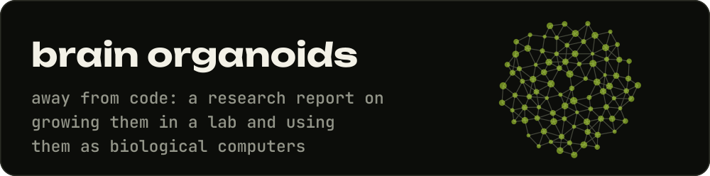
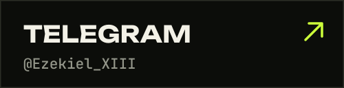
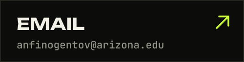
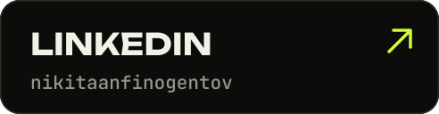

По-русски

 

Учусь на Data Science в Университете Аризоны, живу в Петропавловске и ищу стажировку. Ещё делаю [сайты для малого бизнеса](https://anfinogentov.site/).

Пишу в основном на Python, SQL и JavaScript, для веб-приложений беру FastAPI, PostgreSQL и React. NumPy, scikit-learn и пайплайны данных пока изучаю.

**Что я сделал:**

- [hush-browser](https://github.com/KNate42/hush-browser): модифицированный Firefox, который наконец-то жрёт меньше ОЗУ. На 20 вкладках 820 МиБ с выгрузкой неактивных и 3841 МиБ без неё. Ещё он прячет от сайтов переключение вкладок и вставку текста.
- [schedule](https://github.com/KNate42/schedule): собирает расписание на неделю прямо с телефона и сохраняет его в PNG.
- [ModernSI](https://github.com/KNate42/ModernSI): независимая международная студенческая сеть, где идеи становятся событиями в кампусе.
- [KNate42.github.io](https://knate42.github.io/): моё резюме в виде рабочего стола macOS, разделы открываются окнами.

А вне кода пишу доклад о том, как выращивать в лаборатории мозговые органоиды и использовать их как биологические компьютеры.

Написать мне можно в Telegram [@Ezekiel_XIII](https://t.me/Ezekiel_XIII), на почту anfinogentov@arizona.edu или в [LinkedIn](https://www.linkedin.com/in/nikitaanfinogentov).

